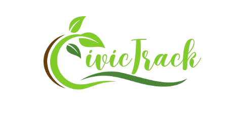
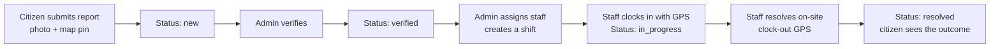
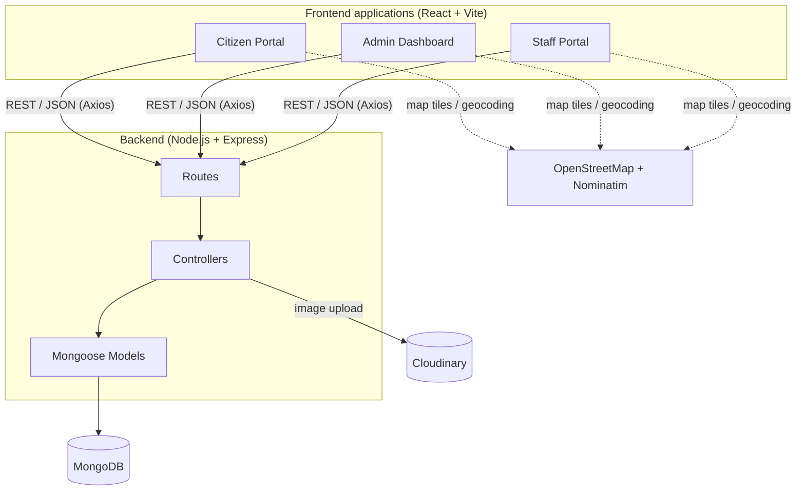

<div align="center">



# EcoTrack

### A community-powered platform to report, verify and resolve environmental incidents.

Citizens report problems with a photo and a map pin. Admins verify them and dispatch field staff. Staff clock in and out on-site with GPS until the issue is resolved.

[](https://ai-developers.vercel.app)


</div>

---

## Table of Contents

- [Overview](#overview)
- [The Problem](#the-problem)
- [Key Features](#key-features)
- [How It Works](#how-it-works)
- [System Architecture](#system-architecture)
- [Tech Stack](#tech-stack)
- [Project Structure](#project-structure)
- [Data Model](#data-model)
- [Getting Started](#getting-started)
- [Environment Variables](#environment-variables)
- [API Reference](#api-reference)
- [Deployment](#deployment)
- [Screenshots](#screenshots)
- [Known Limitations](#known-limitations)
- [Roadmap](#roadmap)
- [Team](#team)
- [Contributing](#contributing)
- [License](#license)

---

## Overview

**EcoTrack** is a full-stack, multi-portal web application that closes the gap between people who **see** environmental problems and the authorities who can **fix** them.

The platform consists of **four connected modules** that share a single REST API and database:

| Module | Audience | Purpose |
|---|---|---|
| **Citizen Portal** (`Frontend/`) | Public users | Register, report incidents with photo and location, track the status of reports |
| **Admin Dashboard** (`Admin/`) | Administrators | Verify reports, analyse trends, manage staff, assign work as shifts |
| **Staff Portal** (`Staff/`) | Field staff | View assigned incidents, clock in/out with GPS, mark incidents resolved |
| **REST API** (`Backend/`) | All of the above | Authentication, business logic, image uploads, analytics |

## The Problem

Illegal dumping, polluted water, air pollution and deforestation are usually noticed first by ordinary people, yet reports often get lost. There is no single place to file them, no proof of the exact location, no accountability for who responds, and no visibility on whether the issue was ever fixed.

EcoTrack provides a **transparent, end-to-end lifecycle**: report, verify, assign, resolve, with location, photo evidence and timestamps recorded at every step.

## Key Features

### Citizen Portal

- Secure registration and login using JWT authentication and bcrypt-hashed passwords
- Optional anonymous reporting for users who prefer privacy
- Incident reporting with title, description and category (`waste`, `water`, `air`, `deforestation`, `other`)
- Interactive map picker (Leaflet + OpenStreetMap) with place search and one-tap "Use my current location"
- Photo evidence upload, stored on Cloudinary
- Personal dashboard to follow the status of every submitted report
- Animated, responsive landing page built with Framer Motion

### Admin Dashboard

- **Analytics overview:** incidents by status and category (Chart.js pie and bar charts), total users, total staff, active shifts and the five most recent incidents
- **Report management:** browse all reports, open a detailed view with map and photo, verify new reports, delete invalid ones
- **Staff directory:** add staff members with a profile photo, view details, remove staff
- **Shift assignment:** assign a staff member to an incident with start and end times
- **Shift monitoring:** track every shift and its status in one place

### Staff Portal

- Staff login with Staff ID and email
- Assigned reports view with incident details, photo and map location
- GPS clock-in and clock-out: the device location is stored when work starts and when the incident is resolved
- Resolved reports history

## How It Works



| Stage | Incident status | Shift status |
|---|---|---|
| Report submitted | `new` | none |
| Verified by admin | `verified` | none |
| Staff assigned | `verified` | `assigned` |
| Work started (clock-in) | `in_progress` | `in_progress` |
| Work completed (clock-out) | `resolved` | `resolved` |

## System Architecture



The backend follows a layered structure (**routes → controllers → models**) with an `/api/<resource>` convention. Each frontend is an independent single-page application that can be deployed on its own.

## Tech Stack

| Layer | Technology |
|---|---|
| **Frontend** | React 19, Vite 6, React Router 7, Tailwind CSS 4, Framer Motion, Lucide and React Icons |
| **Maps** | Leaflet, React-Leaflet, OpenStreetMap, Nominatim geocoding |
| **Charts** | Chart.js, React-Chartjs-2 |
| **HTTP client** | Axios |
| **Backend** | Node.js, Express 5, Mongoose 8 |
| **Database** | MongoDB |
| **Authentication** | JSON Web Tokens, bcryptjs |
| **File storage** | Multer (memory storage), Cloudinary |
| **Hosting** | Vercel |

## Project Structure

```
AI_Developers/
├── Backend/                 # REST API (Express + MongoDB)
│   ├── config/              # Cloudinary configuration
│   ├── controllers/         # User, Staff, Shift, Upload, AdminSummary logic
│   ├── models/              # User, Staff, Incident, Shift, File schemas
│   ├── routes/              # /api/user, /report, /staff, /shift, /admin
│   ├── createAdmin.js       # One-time script to seed the first admin
│   └── index.js             # Application entry point
│
├── Frontend/                # Citizen Portal
│   └── src/
│       ├── pages/           # Home, Login, Register, Report, UserDashboard
│       └── context/         # UserContext (auth state)
│
├── Admin/                   # Admin Dashboard
│   └── src/
│       ├── pages/           # AdminDashBoard, Reports, DetailReports, Staff,
│       │                    # StaffDetail, CreateShift, Shift, Login
│       ├── components/      # SideBar, Navbar
│       └── context/         # AdminContext (auth state)
│
└── Staff/                   # Staff Portal
    └── src/
        ├── pages/           # Login, ReportsProfile, ResolvedReports
        ├── components/      # Navbar
        └── context/         # StaffContext (auth state)
```

## Data Model

| Collection | Key fields |
|---|---|
| **User** | `username`, `email` (unique), `password` (hashed), `role` (`user` or `admin`), `isAnonymous`, `followedReports[]` |
| **Incident** | `title`, `description`, `category`, `status`, `photoUrl`, `latitude`, `longitude`, `createdBy` → User |
| **Staff** | `name`, `email` (unique), `staffId` (unique), `phone`, `address`, `photo` |
| **Shift** | `assignedTo` → Staff, `incident` → Incident, `status`, `startTime`, `endTime`, `clockInLocation`, `clockOutLocation` |

## Getting Started

### Prerequisites

- [Node.js](https://nodejs.org) 18 or later, and npm
- A MongoDB database ([MongoDB Atlas](https://www.mongodb.com/atlas) free tier works well)
- A free [Cloudinary](https://cloudinary.com) account for image uploads

### 1. Clone the repository

```bash
git clone https://github.com/MoinHaiderQadir/AI_Developers.git
cd AI_Developers
```

### 2. Configure and start the backend

```bash
cd Backend
npm install
```

Create a `.env` file in `Backend/` (see [Environment Variables](#environment-variables)), then run:

```bash
# Seed the first admin account (run once, then change the password)
node createAdmin.js

# Start the API on http://localhost:5000
npm start
```

### 3. Start the frontends

Open a separate terminal for each application:

```bash
# Citizen Portal
cd Frontend && npm install && npm run dev

# Admin Dashboard
cd Admin && npm install && npm run dev

# Staff Portal
cd Staff && npm install && npm run dev
```

Vite prints the local URL of each app. The first starts at `http://localhost:5173`, and the others automatically take the next free port.

> **Note:** the frontends currently call the API at `http://localhost:5000`, so the backend must run with `PORT=5000` during local development.

## Environment Variables

Create `Backend/.env`:

```env
PORT=5000
MONGODB_URI=mongodb+srv://<user>:<password>@<cluster>.mongodb.net/civictrack
JWT_SECRET=use-a-long-random-string

CLOUD_NAME=your_cloudinary_cloud_name
CLOUD_API_KEY=your_cloudinary_api_key
CLOUD_API_SECRET=your_cloudinary_api_secret
```

| Variable | Description |
|---|---|
| `PORT` | Port for the API (defaults to `3000`; use `5000` locally to match the frontends) |
| `MONGODB_URI` | MongoDB connection string |
| `JWT_SECRET` | Secret used to sign login tokens (tokens expire after 3 days) |
| `CLOUD_NAME`, `CLOUD_API_KEY`, `CLOUD_API_SECRET` | Cloudinary credentials for photo uploads |

> **Security:** never commit `.env` files or real credentials to version control.

## API Reference

Base path: `/api`

### Users (`/api/user`)

| Method | Endpoint | Description |
|---|---|---|
| `POST` | `/register` | Create an account and receive a JWT |
| `POST` | `/login` | Log in and receive a JWT |

### Reports (`/api/report`)

| Method | Endpoint | Description |
|---|---|---|
| `POST` | `/incidentupload` | Submit a report (multipart form, optional `photo` field) |
| `GET` | `/getall` | List all reports |
| `GET` | `/get/:userId` | List reports created by a user |
| `GET` | `/getreport/:id` | Get a single report |
| `POST` | `/change/:incidentId` | Verify a report (`new` → `verified`) |
| `DELETE` | `/deleteincident/:id` | Delete a report and its related shifts |

### Staff (`/api/staff`)

| Method | Endpoint | Description |
|---|---|---|
| `POST` | `/create` | Add a staff member (multipart form, `photo` field) |
| `GET` | `/get` | List all staff |
| `GET` | `/getstaff/:id` | Get a single staff member |
| `POST` | `/stafflogin` | Staff login with `staffId` and `email` |
| `DELETE` | `/staffdelete/:id` | Remove a staff member |

### Shifts (`/api/shift`)

| Method | Endpoint | Description |
|---|---|---|
| `POST` | `/create` | Assign staff to an incident |
| `GET` | `/get` | List all shifts with staff and incident details |
| `PUT` | `/update/:id` | Update status (`assigned`, `in_progress`, `resolved`) with GPS coordinates |

### Admin (`/api/admin`)

| Method | Endpoint | Description |
|---|---|---|
| `GET` | `/summary` | Dashboard analytics: counts by status and category, totals, recent incidents |

**Example: submit a report**

```bash
curl -X POST http://localhost:5000/api/report/incidentupload \
  -F "title=Illegal dumping near canal" \
  -F "description=Large pile of household waste blocking the drain" \
  -F "category=waste" \
  -F "latitude=25.3960" \
  -F "longitude=68.3578" \
  -F "photo=@./dump.jpg"
```

## Deployment

All four modules are deployed on [Vercel](https://vercel.com) as separate projects from the same repository.

| Project | Root directory | Framework preset | Notes |
|---|---|---|---|
| Citizen Portal | `Frontend` | Vite | Live at [ai-developers.vercel.app](https://ai-developers.vercel.app) |
| Admin Dashboard | `Admin` | Vite | `vercel.json` rewrites all routes to `index.html` for client-side routing |
| Staff Portal | `Staff` | Vite | Same SPA rewrite configuration |
| Backend API | `Backend` | Other (Node) | Add all variables from [Environment Variables](#environment-variables) in the Vercel dashboard |

**Steps**

1. Import the repository in Vercel and create one project per row above, setting the **Root Directory** accordingly.
2. Add the backend environment variables under **Project Settings → Environment Variables**.
3. Point each frontend to the deployed API URL instead of `http://localhost:5000`.
4. Redeploy. Every push to `main` triggers a new deployment automatically.

## Screenshots

<!--
Add screenshots to docs/screenshots/ and uncomment this block.

| Citizen Portal | Report an Incident |
|---|---|
|  |  |

| Admin Dashboard | Staff Portal |
|---|---|
|  |  |
-->

Visit the [live demo](https://ai-developers.vercel.app) to see the Citizen Portal in action.

## Known Limitations

This project is under active development. The following are known gaps, tracked in the [Roadmap](#roadmap):

- JWT verification middleware and role-based access control are not yet enforced on every protected route.
- Staff authenticate with Staff ID and email only (no password).
- Report lists have no pagination, search or filters.
- The API base URL is hard-coded to `http://localhost:5000` in the frontends and must be changed for production.
- There are no automated tests yet.

## Roadmap

- [ ] JWT authentication middleware and role-based access control on every protected route
- [ ] Password-based staff authentication
- [ ] Follow reports and receive status notifications by email
- [ ] Public heat map of incidents by category
- [ ] AI-assisted photo classification to suggest a category automatically
- [ ] Pagination, search and filters on report lists
- [ ] Automated tests (Jest, Supertest) and a CI pipeline with GitHub Actions
- [ ] Multi-language support (English and Urdu)
- [ ] Progressive Web App support for field staff
- [ ] Environment-based API URL configuration for all frontends

## Team

Built by three students of the **University of Sindh, Jamshoro**.

| Member | Role |
|---|---|
| **Sumair Ahmed Dero** | Team Leader, Citizen Portal (`Frontend/`) |
| **Moin Haider Qadir** | Backend API, Admin Dashboard, Deployment ([@MoinHaiderQadir](https://github.com/MoinHaiderQadir)) |
| **Sajida Khoso** | Staff Portal (`Staff/`) |

## Contributing

Contributions, issues and feature requests are welcome.

1. Fork the repository
2. Create a feature branch: `git checkout -b feature/your-feature-name`
3. Commit your changes: `git commit -m "Add your feature"`
4. Push the branch: `git push origin feature/your-feature-name`
5. Open a Pull Request

## License

Distributed under the **MIT License**. See the `LICENSE` file for details.

---

<div align="center">

If you find EcoTrack useful, please consider giving the repository a star.

</div>
